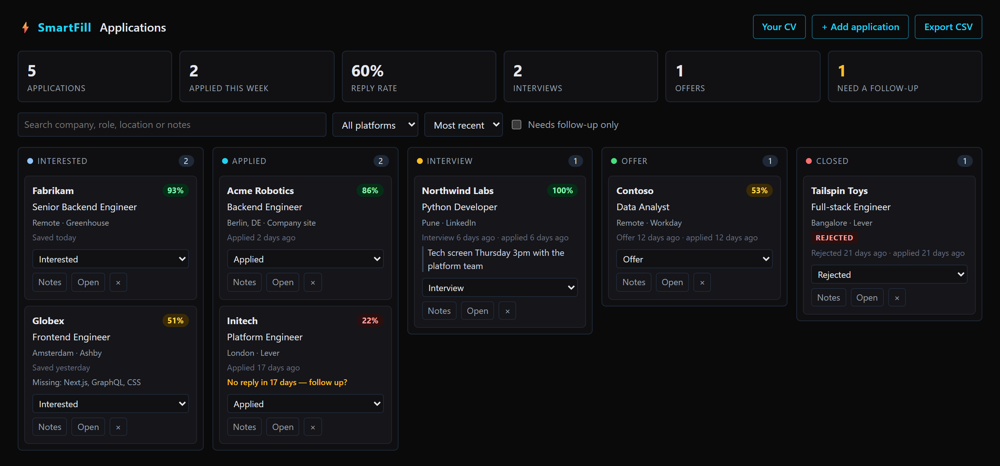

<div align="center">
  

  # SmartFill

  **Fill job applications in seconds, see how well you match, and keep track of every one.** <br>
  *A privacy-first browser extension. Your data stays on your device unless you turn on AI with your own key.*

  <br />

  
  
  
  
  
</div>

<br />

<p align="center">
  
</p>

## Why SmartFill?

Applying for jobs means typing the same name, email, phone number and answers into form after form,
guessing which postings are worth your time, and losing track of where you applied.

SmartFill learns your details from forms you fill once, fills them in for you next time, scores each job
against your CV, and logs every application you submit — all on your device. Add your own Gemini or Groq API
key and it can also draft answers to application questions from your CV and give a detailed AI match analysis.

**It never submits anything for you.** It fills the form; you review it and click Submit yourself.

## Features

### Autofill that learns


- **Learns as you go.** Fill a form once and SmartFill remembers it when you submit. Known field types
  (name, email, phone, address, education, company, job title, experience, notice period, CTC, socials, …)
  carry over to any site. Answers to other questions are remembered by their label and refilled where the
  same question appears again.
- **Colour-coded fields.** Every field SmartFill touches gets an outline:
  - 🟢 **Green** — filled confidently. Check it, then move on.
  - 🟠 **Amber** — a weaker guess. Click the **SF** button to accept it, or type your own.
  - 🔴 **Red** — SmartFill recognised the field (or the page marks it required) but has nothing saved for it.

  Hover a field to see why it has that colour. The outline disappears once you edit the field.
- **Never learns what it shouldn't.** Passwords, OTPs, card, bank and ID numbers, search boxes and login
  forms are never saved.
- **Works in embedded forms** such as Greenhouse application iframes and Google Forms.
- **✦ Draft with AI** (optional) appears on long questions like "Tell us about a project you're proud of" —
  see [AI drafting](#ai-drafting-and-ai-match-optional).

<br clear="right" />

### Match score


Open the popup on a job posting to see how well it fits you before you spend time on the application.

- SmartFill reads the job description and pulls out the **skills** it asks for (required and nice-to-have),
  the **years of experience** and the **degree**.
- It compares them with **your CV** and learned profile: skills count for 70%, experience for 20% and
  degree for 10%. Anything the job doesn't mention is left out instead of counting against you.
- You see the score, the skills you have, what's missing, and how your experience and degree compare.
- This score is worked out entirely in your browser; your CV isn't sent anywhere for it. The popup also has
  optional **✦ Draft answers** and **✦ AI match** buttons (see below).

<br clear="right" />

### Application tracker

Click **Open tracker** in the popup for a full-page board of every application.

- **Logged automatically.** On Greenhouse, Lever, Workday, Ashby, LinkedIn, SmartRecruiters, Wellfound,
  job-application Google Forms and company careers pages, SmartFill records the company, role and location
  when you click the final **Submit** button. "Apply now", "Next" and "Continue" don't count.
- **Save jobs for later** with **Track this job** in the popup. They start in *Interested*.
- **Move cards** from *Interested* → *Applied* → *Interview* → *Offer*, or to *Closed* (rejected or withdrawn),
  by dragging or with the dropdown. Each status change is kept with its date.
- **Stay on top of it:** applications this week, reply rate, interviews, offers, and a nudge when an
  application has had no reply for 14 days.
- **Notes, search, filters, sort by best match, manual entries and CSV export.**
- **No duplicates.** A job's description page, its apply page and an embedded form all count as one job.

Upload your CV (PDF, Word or text) or paste it once in the **Your CV** panel so every job can be scored.
Files are read inside your browser:

<p align="center">
  
</p>

### AI drafting and AI match (optional)

Bring your own **Google Gemini** or **Groq** API key (both have free tiers) and SmartFill can:

- **Draft answers to custom questions** — "Why do you want to work here?", "Tell us about a project you're
  proud of", "Will you need sponsorship?" — written in the first person from **your CV** and the **job
  description**. Use **✦ Draft answers** in the popup for every question on the page, or the **✦ Draft**
  button on a single question.
  - Drafts are outlined **amber**: read and edit each one. SmartFill never submits.
  - The AI is told to use only facts from your CV. When your CV doesn't cover a question (salary, visa,
    start date), it leaves the field empty and tells you why instead of making something up.
  - **Dropdowns, radio buttons and checkbox groups** are answered too ("Are you willing to relocate?",
    "Which of these languages have you used?"), including Google Forms and custom dropdowns such as
    **Workday's** pop-up lists and **React Select** (Greenhouse's newer boards). SmartFill opens each menu
    to read its options, and the AI must pick from them: anything that isn't a real option is thrown away
    instead of guessed. Dropdowns that only show options as you type (like a school search) are left for you.
  - It **never** answers equal-opportunity questions (gender, race, veteran or disability status and the
    like) or ticks consent and "I agree" boxes; those are always left to you.
  - Name, email and phone are still filled by the on-device autofill, never by the AI.
- **Give an AI match analysis** — a 0–100 score with a summary, strengths, gaps and tips for positioning your
  application. Run it from the popup or with the **✦** button on any tracker card; the board shows it next to
  the on-device score, and "Best match" sorting uses it when it's there.

Set it up in the tracker under **✦ AI settings**: pick a provider, paste your key, optionally change the model
(defaults: `gemini-2.5-flash` and `llama-3.3-70b-versatile`), and click **Test connection**.

<p align="center">
  
</p>

**What is sent, and when:** only when you click an AI button, SmartFill sends your CV, your profile details
except email, phone and address, the job description and the questions to the provider you chose. Your API
key is stored only in this browser, is used only by the extension's background worker, and is sent only to
that provider. Nothing is sent if you never add a key.

### Private by design

There is no SmartFill server, account or database. Your profile, CV, API key and applications live in
`chrome.storage.local` on your machine. Autofill, colour-coding, the on-device match score and the tracker
work entirely offline; only the optional AI features contact Gemini or Groq, and only when you ask. The
extension needs access to the pages you visit, to read and fill their forms, and to its own local storage.

## Getting Started

### Install the extension

1. Download **SmartFill.zip** from the landing page (or [`public/SmartFill.zip`](public/SmartFill.zip)) and unzip it.
2. Open `chrome://extensions/` (or `edge://extensions/`).
3. Turn on **Developer mode**.
4. Click **Load unpacked** and pick the unzipped folder (or the `extension` folder of this repository).

Then fill one application form by hand, upload or paste your CV in the tracker's **Your CV** panel, and
SmartFill is ready. For AI drafting, add a Gemini or Groq key under **✦ AI settings**.

### Develop locally

Prerequisites: [Node.js](https://nodejs.org/) 18 or higher, and npm.

```sh
git clone https://github.com/Duggineniakhil/SmartFill.git
cd SmartFill
npm install
```

| Command | What it does |
| --- | --- |
| `npm run dev` | Starts the landing page and dashboard at `http://localhost:8080`. |
| `npm run build:extension` | Compiles the content scripts, popup, tracker and background worker into the checked-in `.js` files under `extension/`, and copies pdf.js into `extension/vendor/`. |
| `npm run package:extension` | Builds the extension and rebuilds `public/SmartFill.zip`, the file the landing page serves. |
| `npm test` | Runs the unit tests (Vitest + jsdom). |
| `npm run test:e2e` | Loads the unpacked extension into Microsoft Edge and checks learning, autofill, iframes, the popup, "Fill this page", the tracker, the match score, CV upload and AI drafting — including real react-select dropdowns — end to end. AI calls are stubbed, so no key is needed. |
| `npm run screenshots` | Regenerates the images in `docs/screenshots/` from the real extension, using a made-up profile. |

`test:e2e` and `screenshots` use Edge by default. Set `SMARTFILL_BROWSER=chromium` to use Playwright's
Chromium instead (branded Chrome 137+ no longer loads unpacked extensions from the command line).

## Project Structure

```
extension/
  manifest.json
  content/
    detectFields.ts   field detection: what each input is, and what must never be saved
    autofill.ts       learning on submit, autofill, SF badges, colour-coded outlines
    matchScore.ts     on-device job requirement extraction and match scoring
    tracker.ts        job-page detection and logging applications on submit
    aiDraft.ts        finding custom questions and filling AI-drafted answers
  popup/              the toolbar popup: job card, match score, AI actions, profile, settings
  tracker/            the full-page application board, CV upload and AI settings
  background/
    background.ts     install defaults; runs AI requests so pages never see your key
    ai.ts             Gemini and Groq client: prompts, requests and response parsing
  vendor/pdfjs/       pdf.js (Apache-2.0), used to read uploaded PDF CVs
src/                  React landing page, dashboard and settings (Vite)
e2e/                  end-to-end test that drives the real extension
scripts/              build, packaging and screenshot scripts
docs/screenshots/     images used in this README
```

## Roadmap

- [x] Local profile storage
- [x] Chrome extension integration
- [x] Smart field detection
- [x] Colour-coded fields (filled, review, missing)
- [x] Application tracker
- [x] On-device match score from your CV
- [x] CV upload (PDF, Word, text)
- [x] AI-drafted answers to custom questions from your CV and the job description (Gemini or Groq)
- [x] Optional AI match analysis
- [x] AI answers for dropdown and multiple-choice questions
- [x] AI answers for custom dropdowns (Workday, React Select and other accessible dropdowns)
- [ ] Multiple profiles
- [ ] Import / export profiles
- [ ] Cloud sync

## License

This project is licensed under the MIT License. It bundles [pdf.js](https://github.com/mozilla/pdf.js)
(Apache-2.0) in `extension/vendor/pdfjs/`.
