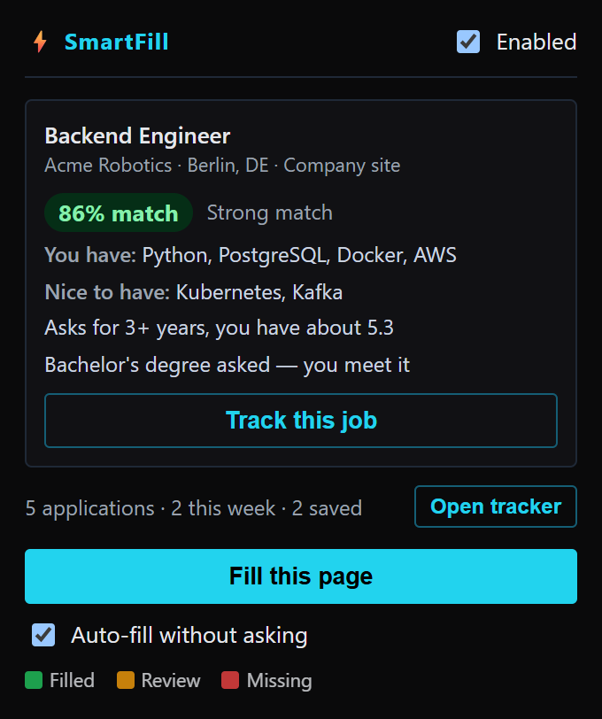
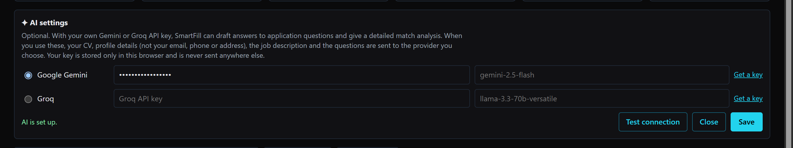

<div align="center">
  

  # SmartFill

  **Apply to jobs in minutes, not hours.** <br>
  *A browser extension that fills your applications, scores how well you match each job, drafts answers to
  custom questions from your CV, and tracks every application you send. It never submits for you.*

  <br />

  **[Website](https://smart-fill-lemon.vercel.app)** · **[Download the extension](https://smart-fill-lemon.vercel.app/SmartFill.zip)** · Free · No account · Chrome, Edge, Brave and Arc

  <br />

  
  
  
  
  
</div>

<br />

<p align="center">
  
</p>

**Works on:** Greenhouse · Lever · Workday · Ashby · LinkedIn · SmartRecruiters · Wellfound · Google Forms ·
company careers pages

## How it works

Four steps. You stay in control.

| | |
| --- | --- |
| **01 · Teach it once** | Fill one application by hand and upload your CV (PDF, Word or text). SmartFill learns your details on your device. |
| **02 · Open a job** | The popup reads the job description and shows how well you match: the skills you have, what's missing, experience and degree. |
| **03 · Fill and draft** | Known fields fill themselves. With your own AI key, custom questions get drafted from your CV. Every field is colour-coded. |
| **04 · You submit** | Review, edit, click Submit yourself. SmartFill logs the application on your tracker board automatically. |

## Features

### Every field, colour-coded


Fill a form once and SmartFill remembers it — name, email, phone, education, links, experience, notice period
and the answers you give to custom questions. Next time, it fills them for you.

- 🟢 **Green** — filled confidently. Check it and move on.
- 🟠 **Amber** — a suggestion or an AI draft. Review it. Click the **SF** button to accept a suggestion.
- 🔴 **Red** — recognised, but nothing saved for it yet.

Hover any field to see why it has that colour; the outline disappears once you edit the field. Works inside
embedded forms like Greenhouse iframes and Google Forms.

<br clear="right" />

### Know what's worth your time — match score



Open the popup on any posting. SmartFill reads the job description, pulls out the skills it asks for (required
and nice-to-have), the years of experience and the degree, and compares them with your CV.

You get a 0–100 score with the skills you have and what's missing — worked out entirely in your browser.
Skills count for 70%, experience for 20% and degree for 10%; anything the job doesn't mention is left out
instead of counting against you.

With an AI key, **✦ AI match** adds a recruiter-style read: a summary, strengths, gaps and tips for positioning
your application.

<br clear="right" />

### Custom questions, drafted from your CV (optional AI)

Bring your own **Google Gemini** or **Groq** API key (both have free tiers). Then **✦ Draft answers** in the
popup — or the **✦ Draft** button on a single question — writes first-person answers to questions like "Why do
you want to work here?" using your CV and the job description.

- **Answers dropdowns, radio buttons and checkboxes too** — including Google Forms, Workday's pop-up lists and
  React Select menus on Greenhouse. SmartFill opens each menu to read its options, and the AI must pick from the
  real options; anything else is thrown away. Dropdowns that only show options as you type are left for you.
- **Drafts are outlined amber** so you read and edit each one before submitting.
- **No made-up facts.** If your CV doesn't cover a question (salary, visa, start date), the field stays empty
  and the popup tells you why.
- Name, email and phone are filled by the on-device autofill, never by the AI.

Set it up in the tracker under **✦ AI settings**: pick a provider, paste your key, optionally change the model
(defaults: `gemini-3.8-flash` and `openai/gpt-oss-120b`), and click **Test connection**. Add both keys and the
other provider takes over automatically whenever your chosen one fails or is overloaded.

<p align="center">
  
</p>

### From Interested to Offer — application tracker

Click Submit on Greenhouse, Lever, Workday, Ashby, LinkedIn or a company careers page and the application lands
on your board with the company, role, location and date. Save jobs for later with **Track this job** in the
popup. Open the board with **Open tracker**.

- **Drag cards** through *Interested* → *Applied* → *Interview* → *Offer*, or to *Closed* (rejected or
  withdrawn). Each status change is kept with its date.
- **Stay on top of it:** applications this week, reply rate, interviews, offers — and a nudge after 14 days
  with no reply.
- **Notes, search, filters, sort by best match, manual entries and CSV export.**
- **No duplicates.** A job's description page, its apply page and an embedded form all count as one job.
  "Apply now", "Next" and "Continue" don't log anything — only the final Submit does.

### Upload your CV once

Upload a PDF, Word (.docx) or text file, or paste it in. The file is read inside your browser, and SmartFill
shows what it understood — skills, years of experience and degree — so every job can be scored.

<p align="center">
  
</p>

## Privacy & safety — lazy, not reckless

Everything except the optional AI works offline, on your device. Here's exactly where the lines are.

- **It never submits.** SmartFill fills and drafts. You review every field and click Submit yourself.
- **Your data stays local.** Profile, CV, applications and API key live in your browser's storage
  (`chrome.storage.local`). There's no SmartFill server, account or telemetry.
- **AI is opt-in.** Nothing is sent anywhere until you add your own Gemini or Groq key and click an AI button.
  Then your CV, the job description and the questions go to that provider (or, if it fails and you added a second
  key, to the other one) — never your email, phone or address.
  Your key is used only by the extension's background worker and sent only to that provider.
- **No made-up facts.** The AI may only use what's in your CV. If your CV doesn't answer a question, the field
  stays empty and you're told why.
- **Some things are always yours.** Equal-opportunity questions (gender, race, veteran, disability…), consent
  and "I agree" boxes are never touched.
- **Never learns secrets.** Passwords, OTPs, card, bank and ID numbers, search boxes and login forms are
  ignored — never captured, never filled.

## Install in 2 minutes

1. [Download the .zip](https://smart-fill-lemon.vercel.app/SmartFill.zip) and unzip it somewhere you'll remember.
2. Open `chrome://extensions` (or `edge://extensions`).
3. Toggle **Developer mode** on (top-right).
4. Click **Load unpacked** and pick the unzipped folder (or the `extension` folder of this repository). Pin
   SmartFill to your toolbar.
5. Click **Open tracker** in the popup, then **Your CV**: upload or paste your CV.
6. Optional: under **✦ AI settings**, add a Gemini or Groq key and click **Test connection**.
7. Fill your next application by hand once — from then on, SmartFill takes it from there.

## Develop locally

Prerequisites: [Node.js](https://nodejs.org/) 18 or higher, and npm.

```sh
git clone https://github.com/Duggineniakhil/SmartFill.git
cd SmartFill
npm install
```

| Command | What it does |
| --- | --- |
| `npm run dev` | Starts the website (landing page, dashboard and settings) at `http://localhost:8080`. |
| `npm run build` | Builds the website for production into `dist/`. The live site redeploys from `main`. |
| `npm run build:extension` | Compiles the content scripts, popup, tracker and background worker into the checked-in `.js` files under `extension/`, and copies pdf.js into `extension/vendor/`. |
| `npm run package:extension` | Builds the extension and rebuilds `public/SmartFill.zip`, the file the website serves. |
| `npm test` | Runs the unit tests (Vitest + jsdom). |
| `npm run test:e2e` | Loads the unpacked extension into Microsoft Edge and checks learning, autofill, iframes, the popup, "Fill this page", the tracker, the match score, CV upload and AI drafting — including real react-select dropdowns — end to end. AI calls are stubbed, so no key is needed. |
| `npm run screenshots` | Regenerates the images in `docs/screenshots/` from the real extension, using a made-up profile. |

`test:e2e` and `screenshots` use Edge by default. Set `SMARTFILL_BROWSER=chromium` to use Playwright's
Chromium instead (branded Chrome 137+ no longer loads unpacked extensions from the command line).

## Project Structure

```
extension/
  manifest.json
  content/
    detectFields.ts   field detection: what each input is, and what must never be saved
    autofill.ts       learning on submit, autofill, SF badges, colour-coded outlines
    matchScore.ts     on-device job requirement extraction and match scoring
    tracker.ts        job-page detection and logging applications on submit
    aiDraft.ts        finding custom questions and filling AI-drafted answers
  popup/              the toolbar popup: job card, match score, AI actions, profile, settings
  tracker/            the full-page application board, CV upload and AI settings
  background/
    background.ts     install defaults; runs AI requests so pages never see your key
    ai.ts             Gemini and Groq client: prompts, requests and response parsing
  vendor/pdfjs/       pdf.js (Apache-2.0), used to read uploaded PDF CVs
src/                  the website: landing page, dashboard and settings (React + Vite)
e2e/                  end-to-end test that drives the real extension
scripts/              build, packaging and screenshot scripts
docs/screenshots/     images used in this README and on the website
```

## Roadmap

- [x] Local profile storage
- [x] Chrome extension integration
- [x] Smart field detection
- [x] Colour-coded fields (filled, review, missing)
- [x] Application tracker
- [x] On-device match score from your CV
- [x] CV upload (PDF, Word, text)
- [x] AI-drafted answers to custom questions from your CV and the job description (Gemini or Groq)
- [x] Optional AI match analysis
- [x] AI answers for dropdown and multiple-choice questions
- [x] AI answers for custom dropdowns (Workday, React Select and other accessible dropdowns)
- [ ] Multiple profiles
- [ ] Import / export profiles
- [ ] Cloud sync

## License

This project is licensed under the MIT License. It bundles [pdf.js](https://github.com/mozilla/pdf.js)
(Apache-2.0) in `extension/vendor/pdfjs/`.
