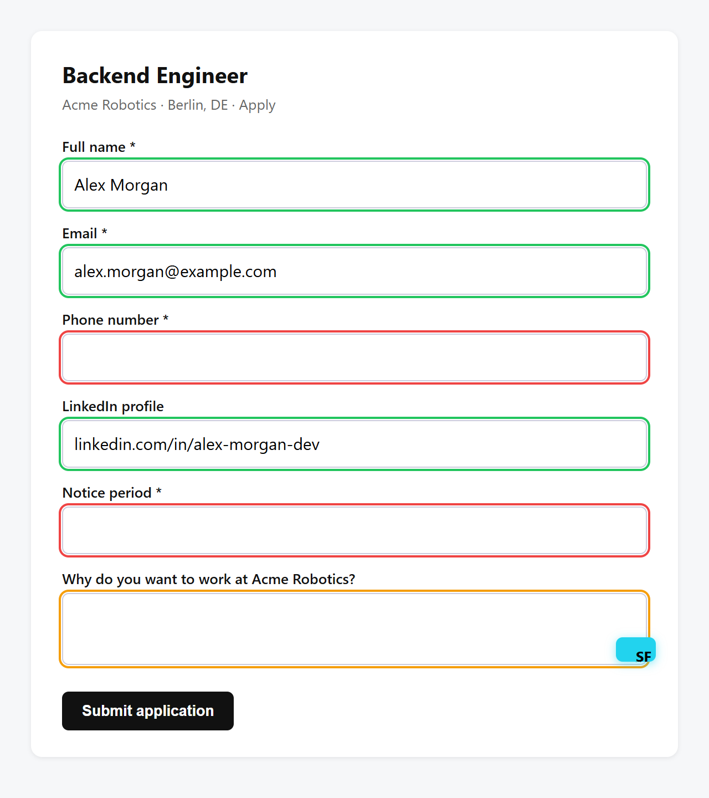
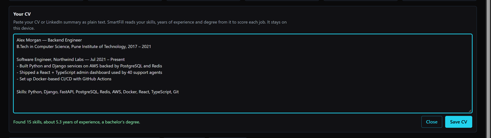

<div align="center">
  

  # SmartFill

  **Fill job applications in seconds, see how well you match, and keep track of every one.** <br>
  *A privacy-first browser extension. Everything stays on your device.*

  <br />

  
  
  
  
  
</div>

<br />

<p align="center">
  
</p>

## Why SmartFill?

Applying for jobs means typing the same name, email, phone number and answers into form after form,
guessing which postings are worth your time, and losing track of where you applied.

SmartFill learns your details from forms you fill once, fills them in for you next time, scores each job
against your CV, and logs every application you submit — without sending anything off your device.

**It never submits anything for you.** It fills the form; you review it and click Submit yourself.

## Features

### Autofill that learns



- **Learns as you go.** Fill a form once and SmartFill remembers it when you submit. Known field types
  (name, email, phone, address, education, company, job title, experience, notice period, CTC, socials, …)
  carry over to any site. Answers to other questions are remembered by their label and refilled where the
  same question appears again.
- **Colour-coded fields.** Every field SmartFill touches gets an outline:
  - 🟢 **Green** — filled confidently. Check it, then move on.
  - 🟠 **Amber** — a weaker guess. Click the **SF** button to accept it, or type your own.
  - 🔴 **Red** — SmartFill recognised the field (or the page marks it required) but has nothing saved for it.

  Hover a field to see why it has that colour. The outline disappears once you edit the field.
- **Never learns what it shouldn't.** Passwords, OTPs, card, bank and ID numbers, search boxes and login
  forms are never saved.
- **Works in embedded forms** such as Greenhouse application iframes and Google Forms.

<br clear="right" />

### Match score


Open the popup on a job posting to see how well it fits you before you spend time on the application.

- SmartFill reads the job description and pulls out the **skills** it asks for (required and nice-to-have),
  the **years of experience** and the **degree**.
- It compares them with **your CV** and learned profile: skills count for 70%, experience for 20% and
  degree for 10%. Anything the job doesn't mention is left out instead of counting against you.
- You see the score, the skills you have, what's missing, and how your experience and degree compare.
- Scoring runs entirely in your browser. Your CV is never uploaded anywhere.

<br clear="right" />

### Application tracker

Click **Open tracker** in the popup for a full-page board of every application.

- **Logged automatically.** On Greenhouse, Lever, Workday, Ashby, LinkedIn, SmartRecruiters, Wellfound,
  job-application Google Forms and company careers pages, SmartFill records the company, role and location
  when you click the final **Submit** button. "Apply now", "Next" and "Continue" don't count.
- **Save jobs for later** with **Track this job** in the popup. They start in *Interested*.
- **Move cards** from *Interested* → *Applied* → *Interview* → *Offer*, or to *Closed* (rejected or withdrawn),
  by dragging or with the dropdown. Each status change is kept with its date.
- **Stay on top of it:** applications this week, reply rate, interviews, offers, and a nudge when an
  application has had no reply for 14 days.
- **Notes, search, filters, sort by best match, manual entries and CSV export.**
- **No duplicates.** A job's description page, its apply page and an embedded form all count as one job.

Paste your CV once in the **Your CV** panel so every job can be scored:

<p align="center">
  
</p>

### Private by design

There is no server, account or database. Your profile, CV and applications live in `chrome.storage.local`
on your machine. The extension only needs access to the pages you visit, to read and fill their forms,
and to its own local storage.

## Getting Started

### Install the extension

1. Download **SmartFill.zip** from the landing page (or [`public/SmartFill.zip`](public/SmartFill.zip)) and unzip it.
2. Open `chrome://extensions/` (or `edge://extensions/`).
3. Turn on **Developer mode**.
4. Click **Load unpacked** and pick the unzipped folder (or the `extension` folder of this repository).

Then fill one application form by hand, paste your CV in the tracker's **Your CV** panel, and SmartFill
is ready.

### Develop locally

Prerequisites: [Node.js](https://nodejs.org/) 18 or higher, and npm.

```sh
git clone https://github.com/Duggineniakhil/SmartFill.git
cd SmartFill
npm install
```

| Command | What it does |
| --- | --- |
| `npm run dev` | Starts the landing page and dashboard at `http://localhost:8080`. |
| `npm run build:extension` | Compiles the content scripts, popup and tracker into the checked-in `.js` files under `extension/`. |
| `npm run package:extension` | Builds the extension and rebuilds `public/SmartFill.zip`, the file the landing page serves. |
| `npm test` | Runs the unit tests (Vitest + jsdom). |
| `npm run test:e2e` | Loads the unpacked extension into Microsoft Edge and checks learning, autofill, iframes, the popup, "Fill this page", the tracker and the match score end to end. |
| `npm run screenshots` | Regenerates the images in `docs/screenshots/` from the real extension, using a made-up profile. |

`test:e2e` and `screenshots` use Edge by default. Set `SMARTFILL_BROWSER=chromium` to use Playwright's
Chromium instead (branded Chrome 137+ no longer loads unpacked extensions from the command line).

## Project Structure

```
extension/
  manifest.json
  content/
    detectFields.ts   field detection: what each input is, and what must never be saved
    autofill.ts       learning on submit, autofill, SF badges, colour-coded outlines
    matchScore.ts     on-device job requirement extraction and match scoring
    tracker.ts        job-page detection and logging applications on submit
  popup/              the toolbar popup: job card, match score, profile, settings
  tracker/            the full-page application board and CV panel
  background/         install defaults
src/                  React landing page, dashboard and settings (Vite)
e2e/                  end-to-end test that drives the real extension
scripts/              build, packaging and screenshot scripts
docs/screenshots/     images used in this README
```

## Roadmap

- [x] Local profile storage
- [x] Chrome extension integration
- [x] Smart field detection
- [x] Colour-coded fields (filled, review, missing)
- [x] Application tracker
- [x] On-device match score from your CV
- [ ] Answers to custom questions drafted from your CV and the job description
- [ ] Multiple profiles
- [ ] Import / export profiles
- [ ] Optional AI-assisted matching
- [ ] Cloud sync

## License

This project is licensed under the MIT License.
